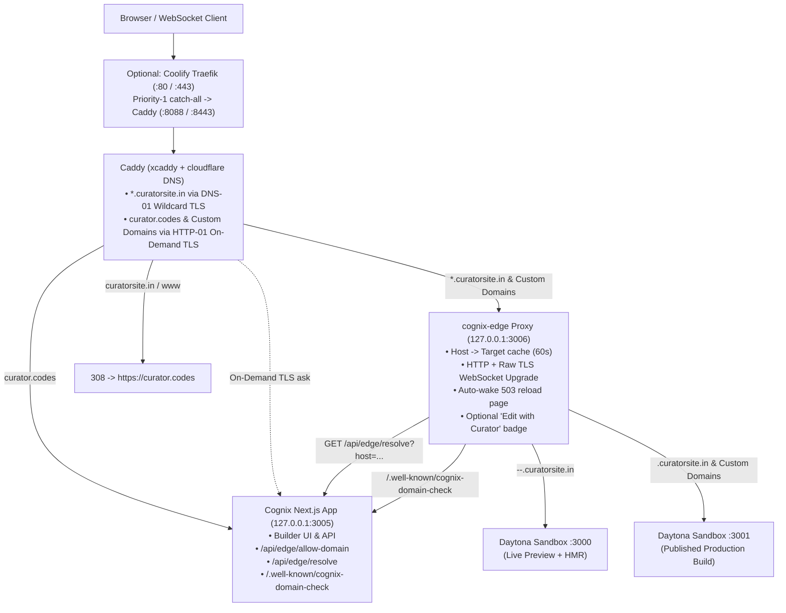

# Cognix / Curator — Daytona Custom Preview Proxy, Wildcard Previews & Custom Domains Infrastructure

This `Infra/` directory contains the complete architecture, reference code, `systemd` services, Caddy & Traefik configurations, Cloudflare DNS automation, and verification scripts to self-host **Cognix (Curator)** with:

1. **Main Builder Domain** (e.g. `https://curator.codes`) — hosts the Next.js App Router builder, Auth0 login, API routes, and Cognix Cloud control plane.
2. **Dedicated Apps Domain** (e.g. `*.curatorsite.in`) — isolated from builder cookies/sessions:
   - `https://curatorsite.in` & `https://www.curatorsite.in` → `308 Permanent Redirect` to `https://curator.codes`.
   - `https://<adj>-<noun>-<hex8>.curatorsite.in` → **Live Dev Preview** proxied directly to Daytona sandbox port `3000` (including Next.js HMR WebSockets, no Daytona warning screen, no Daytona URL exposed).
   - `https://<slug>.curatorsite.in` → **Published App** proxied directly to Daytona sandbox port `3001` (with scale-to-zero auto-wake and optional `"Edit with Curator"` badge injection).
   - `edge.curatorsite.in` → Public `CNAME` target for customer custom domains.
3. **Unlimited Customer Custom Domains** (e.g. `https://app.customer.com` or `https://customer.com`) — verified via `_cognix-challenge.<host>` DNS `TXT` record + live HTTPS probe (`/.well-known/cognix-domain-check`), with automatic Let's Encrypt **On-Demand TLS** certificates gated by `/api/edge/allow-domain`.

> [!TIP]
> **Using an AI Agent to set up your server?** Point your agent directly at [AGENT_SETUP_PLAYBOOK.md](./AGENT_SETUP_PLAYBOOK.md). It provides an idempotent, phase-by-phase runbook with secret-hygiene rules and verification gates.

---

## Directory Contents

```text
Infra/
├── README.md                        # Human architecture & step-by-step setup guide (this file)
├── AGENT_SETUP_PLAYBOOK.md          # Autonomous AI agent runbook & verification contract
├── caddy/
│   ├── Caddyfile.standalone         # Caddy config when Caddy owns ports 80 & 443 directly
│   └── Caddyfile.behind-traefik     # Caddy config behind Coolify / Traefik TCP SNI passthrough
├── traefik/
│   └── cognix-dynamic.yaml          # Drop-in Coolify / Traefik dynamic router for zero-conflict coexistence
├── proxy/
│   └── edge-proxy.mjs               # Zero-dependency Node 22+ HTTP + WebSocket Daytona preview proxy
├── systemd/
│   ├── cognix-app.service           # Next.js production server (127.0.0.1:3005)
│   ├── cognix-edge.service          # Daytona custom preview & domain proxy (127.0.0.1:3006)
│   └── cognix-caddy.service         # Custom-built Caddy (xcaddy + cloudflare DNS-01)
├── env/
│   └── cognix-infra.env.example     # Environment variables for Caddy & cognix-edge
└── scripts/
    ├── setup-cloudflare-dns.mjs     # Idempotent Cloudflare DNS setup (preserves existing records)
    └── verify-infra.sh              # End-to-end health, TLS, redirect, and proxy check script
```

*(Note: Live runtime copies used on the VM also exist at [../vm/Caddyfile](../vm/Caddyfile) and [../vm/edge-proxy.mjs](../vm/edge-proxy.mjs), and an alternative serverless Cloudflare for SaaS worker is in [../cloudflare/edge-worker.js](../cloudflare/edge-worker.js).)*

---

## End-to-End Architecture



### How Daytona Custom Preview Proxy Routing Works

Per [Daytona's Custom Preview Proxy specification](https://www.daytona.io/docs/en/custom-preview-proxy/):

1. **Secrets stay on the Cognix server:** `DAYTONA_API_KEY` never leaves `cognix-app` (`127.0.0.1:3005`).
2. **Dynamic Lookup (`GET /api/edge/resolve?host=<hostname>`):**
   - Authenticated with `x-cognix-edge-secret: <COGNIX_EDGE_SECRET>`.
   - Inspects `<hostname>`:
     - **Preview host** (`<adj>-<noun>-<hex8>.<COGNIX_APPS_DOMAIN>`, e.g. `amber-orbit-d4ebb9ff.curatorsite.in`) → looks up the project, ensures the Daytona sandbox and dev server (`:3000`) are running, fetches a short-lived signed Daytona preview URL/token via `sandbox.getPreviewLink(3000)`, and returns `{ kind: "preview", upstream, headers, cacheSeconds: 60 }`.
     - **Published subdomain** (`<slug>.<COGNIX_APPS_DOMAIN>`) or **verified custom domain** (`app.customer.com`) → looks up the published project, wakes the sandbox and restarts the saved production release on `:3001` if idle-stopped (`COGNIX_PUBLISHED_AUTOSTOP_MINUTES`), and returns `{ upstream, headers, badge, cacheSeconds: 60 }`.
     - If the sandbox is still booting, returns `HTTP 503` so `edge-proxy.mjs` serves a clean dark auto-refreshing **"This app is restarting / This preview is starting"** page instead of a raw `502 Bad Gateway`.
3. **Upstream Request & WebSocket Forwarding:**
   `edge-proxy.mjs` strips any visitor-spoofed `x-cognix-*` or `x-daytona-*` headers, sets `Host` to Daytona's proxy host, and injects the exact Daytona headers returned by Cognix:
   - `X-Daytona-Preview-Token: <per-sandbox-token>`
   - `X-Daytona-Skip-Preview-Warning: true` *(removes Daytona's phishing/interstitial warning)*
   - `X-Daytona-Disable-CORS: true` *(lets the Next.js app enforce its own CORS rules)*
   - `X-Forwarded-Host: <visitor-hostname>`
   - `X-Daytona-Trust-Forwarded-Host: true` *(ensures Next.js Server Actions, Better Auth, and redirects see the visitor's real domain)*
   - Rewrites upstream `Location` redirect headers so visitors never bounce onto `*.proxy.daytona.works`.

---

## Step 1: DNS Setup (Cloudflare Recommended)

Assume:
- **VM Public IPv4:** `203.0.113.10` *(replace with your VM IP)*
- **Builder Domain:** `curator.codes`
- **Apps Preview/Publish Domain:** `curatorsite.in`

> [!IMPORTANT]
> Set all records below to **DNS Only (`proxied: false` / grey cloud)** in Cloudflare!
> Why? Caddy terminates TLS directly on your VM (including Let's Encrypt HTTP-01 On-Demand TLS for arbitrary customer custom domains and wildcard DNS-01 for `*.curatorsite.in`) and forwards long-lived raw WebSocket upgrades. Orange-cloud proxying breaks customer CNAMEs unless you purchase Cloudflare for SaaS.

### Zone 1: Builder Domain (`curator.codes`)

| Type | Name | Content / Target | Proxy Status | TTL | Purpose |
| :--- | :--- | :--- | :--- | :--- | :--- |
| `A` | `@` (`curator.codes`) | `203.0.113.10` | **DNS only** | Auto | Main Cognix builder UI & API |
| `CNAME` | `www` | `curator.codes` | **DNS only** | Auto | `308` redirects to `https://curator.codes` |

### Zone 2: Apps Preview & Publish Domain (`curatorsite.in`)

| Type | Name | Content / Target | Proxy Status | TTL | Purpose |
| :--- | :--- | :--- | :--- | :--- | :--- |
| `A` | `@` (`curatorsite.in`) | `203.0.113.10` | **DNS only** | Auto | `308` redirects to `https://curator.codes` |
| `A` | `*` (`*.curatorsite.in`) | `203.0.113.10` | **DNS only** | Auto | Random preview slugs & published `<slug>.curatorsite.in` apps |
| `A` | `edge` (`edge.curatorsite.in`) | `203.0.113.10` | **DNS only** | Auto | Explicit `CNAME` target customers point custom domains to |

### Automated DNS Script

Create a Cloudflare API Token with **`Zone → DNS → Edit`** on both zones (this same token is also used by Caddy for wildcard DNS-01 issuance on `*.curatorsite.in`), then run:

```bash
CLOUDFLARE_API_TOKEN="your_cf_dns_edit_token" \
BUILDER_ZONE_ID="your_builder_zone_id" \
BUILDER_DOMAIN="curator.codes" \
APPS_ZONE_ID="your_apps_zone_id" \
APPS_DOMAIN="curatorsite.in" \
VM_IPV4="203.0.113.10" \
node Infra/scripts/setup-cloudflare-dns.mjs
```

*(The script only upserts `@`, `www`, `*`, and `edge`—any other existing subdomains on your zones remain untouched.)*

### Customer Custom Domain DNS (What End Users Add)

When a user attaches `app.example.com` (subdomain) or `example.com` (apex domain) in **Cloud → Domains**, Cognix generates two records:
1. **Ownership `TXT`:** `_cognix-challenge.app.example.com` → `cognix-domain-verification=<token>`
2. **Routing:**
   - Subdomain (`app.example.com`): `CNAME` → `edge.curatorsite.in`
   - Apex/root (`example.com`): `A` → `203.0.113.10`

When the user clicks **Check DNS**, Cognix (`src/lib/dns.ts`):
1. Queries Google & Cloudflare DNS-over-HTTPS (`1.1.1.1` and `8.8.8.8`) to verify both the `TXT` token and `CNAME`/`A` target.
2. Makes a real HTTPS request to `https://<customer-domain>/.well-known/cognix-domain-check` (with 20s timeout + automatic retry so Caddy's first-handshake Let's Encrypt On-Demand TLS issuance completes cleanly).
3. Marks the domain **Live** only when Caddy serves valid HTTPS and `edge-proxy.mjs` routes the probe back to Cognix with the matching project & verification token.

---

## Step 2: Build Caddy with Cloudflare DNS Module (`xcaddy`)

Standard apt Caddy binaries do not include the Cloudflare DNS-01 plugin needed for wildcard `*.curatorsite.in` certificates. Build `/usr/local/bin/caddy` on your Ubuntu/Debian VM:

```bash
sudo apt-get update && sudo apt-get install -y curl git ca-certificates debian-keyring debian-archive-keyring apt-transport-https

# Install Go 1.23+ if not present, then install xcaddy:
go install github.com/caddyserver/xcaddy/cmd/xcaddy@latest
~/go/bin/xcaddy build --with github.com/caddy-dns/cloudflare --output /tmp/caddy

sudo mv /tmp/caddy /usr/local/bin/caddy
sudo chmod +x /usr/local/bin/caddy
sudo setcap cap_net_bind_service=+ep /usr/local/bin/caddy
/usr/local/bin/caddy list-modules | grep dns.providers.cloudflare
```

---

## Step 3: Deploy Cognix Application & Secrets on the VM

1. **Create directories & copy files:**

```bash
sudo mkdir -p /opt/cognix/app /etc/cognix /var/lib/caddy /var/log/caddy
```

2. **Configure `/opt/cognix/app/.env.production` (`chmod 600`):**

```dotenv
NODE_ENV=production
APP_BASE_URL=https://curator.codes
COGNIX_APP_HOSTS=curator.codes,www.curator.codes
COGNIX_APPS_DOMAIN=curatorsite.in
COGNIX_DOMAIN_CNAME_TARGET=edge.curatorsite.in
COGNIX_DOMAIN_IPV4=203.0.113.10
COGNIX_EDGE_SECRET=<generate-with-openssl-rand-hex-32>
COGNIX_PUBLISHED_AUTOSTOP_MINUTES=15
COGNIX_SECRETS_KEY=<generate-with-openssl-rand-base64-32>

# Database, Auth0, Daytona, Model, Neon Cloud, GCS, GitHub:
DATABASE_URL=postgresql://...
NEON_API_KEY=...
NEON_ORG_ID=...
NEON_DEFAULT_REGION=aws-us-east-1
AUTH0_DOMAIN=...
AUTH0_CLIENT_ID=...
AUTH0_CLIENT_SECRET=...
AUTH0_SECRET=...
DAYTONA_API_KEY=...
DAYTONA_API_URL=https://app.daytona.io/api
DAYTONA_TARGET=us
OPENAI_API_KEY=...
OPENAI_BASE_URL=https://api.openai.com/v1
OPENAI_MODEL=...
GOOGLE_CLOUD_PROJECT=...
GOOGLE_STORAGE_BUCKET=...
GOOGLE_APPLICATION_CREDENTIALS=/opt/cognix/gcs-service-account.json
```

```bash
sudo chmod 600 /opt/cognix/app/.env.production /opt/cognix/gcs-service-account.json
```

3. **Install dependencies, push DB schema, and build Next.js:**

```bash
cd /opt/cognix/app
npm ci
npx drizzle-kit push
npm run build
```

---

## Step 4: Configure Caddy, Edge Proxy & Systemd Services

1. **Create `/etc/cognix/infra.env` from [`Infra/env/cognix-infra.env.example`](./env/cognix-infra.env.example):**

```bash
sudo cp /opt/cognix/app/Infra/env/cognix-infra.env.example /etc/cognix/infra.env
sudo chmod 600 /etc/cognix/infra.env
# Edit /etc/cognix/infra.env and set COGNIX_EDGE_SECRET (must match .env.production) and CLOUDFLARE_API_TOKEN
```

2. **Choose your Caddy topology:**

   - **Topology A — Standalone VM (nothing else using ports 80/443):**
     ```bash
     sudo cp /opt/cognix/app/Infra/caddy/Caddyfile.standalone /etc/cognix/Caddyfile
     ```
   - **Topology B — Shared VM running Coolify / Traefik (`coolify-proxy` already bound to `:80` and `:443`):**
     Keep Coolify untouched! Bind Caddy on `127.0.0.1` + Docker bridge `10.0.0.1` ports `8088` / `8443` and drop a lowest-priority (`priority: 1`) catch-all SNI passthrough router into Coolify's dynamic folder:
     ```bash
     sudo cp /opt/cognix/app/Infra/caddy/Caddyfile.behind-traefik /etc/cognix/Caddyfile
     sudo cp /opt/cognix/app/Infra/traefik/cognix-dynamic.yaml /data/coolify/proxy/dynamic/cognix.yaml
     ```
     *Why `servers { protocols h1 h2 }` in `Caddyfile.behind-traefik`?* When Caddy listens internally on `:8443`, HTTP/3 would advertise `Alt-Svc: h3=":8443"`, causing browsers to attempt UDP `:8443` directly instead of `:443`. Restricting internal Caddy to `h1 h2` prevents `:8443` from ever leaking.

3. **Install and enable the 3 `systemd` services:**

```bash
sudo cp /opt/cognix/app/Infra/proxy/edge-proxy.mjs /opt/cognix/edge-proxy.mjs
sudo cp /opt/cognix/app/Infra/systemd/cognix-app.service /etc/systemd/system/
sudo cp /opt/cognix/app/Infra/systemd/cognix-edge.service /etc/systemd/system/
sudo cp /opt/cognix/app/Infra/systemd/cognix-caddy.service /etc/systemd/system/

sudo systemctl daemon-reload
sudo systemctl enable --now cognix-app.service cognix-edge.service cognix-caddy.service
```

---

## Step 5: Verify Everything

Run the included verification script on the VM:

```bash
COGNIX_BUILDER_DOMAIN=curator.codes \
COGNIX_APPS_DOMAIN=curatorsite.in \
COGNIX_EDGE_SECRET="<your-edge-secret>" \
bash /opt/cognix/app/Infra/scripts/verify-infra.sh
```

Expected checks:
- `http://127.0.0.1:3005/api/health` → `{"ok":true,...}`
- `http://127.0.0.1:3006/_cognix-edge/healthz` → `ok`
- `/api/edge/allow-domain` → returns `200` for `curator.codes` & `test.curatorsite.in`, and `404` for unattached domains (`unregistered-example.invalid`) so scanners cannot abuse Let's Encrypt rate limits.
- `https://curator.codes` → `HTTP 200`
- `https://curatorsite.in` & `https://www.curatorsite.in` → `HTTP 308` `Location: https://curator.codes`

---

## Troubleshooting

| Symptom | Root Cause | Fix |
| :--- | :--- | :--- |
| Custom domain shows *"Needs attention: could not be reached through edge.curatorsite.in"* on first click | First-time Let's Encrypt HTTP-01 issuance takes 4–10 seconds, or port `80` is intercepted by another proxy before reaching Caddy | Click **Check DNS** once more after 5s, or ensure port `80` forwards `/.well-known/acme-challenge/*` to Caddy (`8088` behind Traefik). |
| Browser fails after first load on custom domain behind Traefik | Caddy advertised `Alt-Svc: h3=":8443"` | Ensure `servers { protocols h1 h2 }` is in `/etc/cognix/Caddyfile` (included in `Caddyfile.behind-traefik`) and reload `cognix-caddy`. |
| Preview HMR / WebSockets disconnect | Upstream proxy buffering or missing `Upgrade` header | Keep Cloudflare DNS records **grey-cloud (`proxied: false`)**; `edge-proxy.mjs` handles raw TCP/TLS `upgrade` sockets directly to Daytona. |
| `allow-domain` returns `403 forbidden` | `COGNIX_EDGE_SECRET` mismatch between `/etc/cognix/infra.env` and `/opt/cognix/app/.env.production` | Set identical `COGNIX_EDGE_SECRET` in both files and restart `cognix-app`, `cognix-edge`, and `cognix-caddy`. |
| Existing Coolify apps broke after adding Traefik config | Router priority set too high | Keep `priority: 1` in `/data/coolify/proxy/dynamic/cognix.yaml` so specific `Host(...)` rules from Coolify (priority ~10–100+) always win first. |
