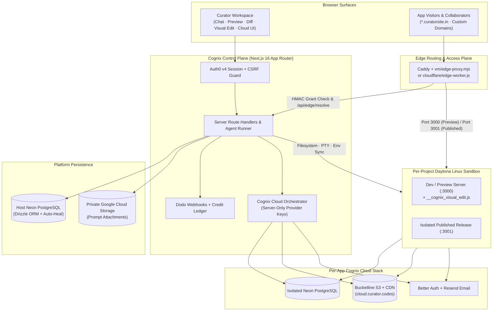

# Curator (Cognix) — Open-Source Full-Stack AI App Builder

**Curator** (*Cognix AI App Builder*) is a production-grade, self-hostable prompt-to-full-stack-application platform built with **Next.js 16 (App Router)**, **Daytona Linux sandboxes**, and **Cognix Cloud**.

Every project runs inside its own isolated Linux container with real terminal execution, two-way GitHub sync, point-and-click visual editing, zero-downtime production publishing, custom domains, preview access controls, integrated billing & credit metering, and an autonomous **Cognix Cloud** backend stack (serverless **Neon PostgreSQL**, **Better Auth**, **S3 Object Storage & CDN**, and **Resend** transactional email).

---

## Support Us

- **Buy Me a Coffee**: [https://buymeacoffee.com/cognix/](https://buymeacoffee.com/cognix/)
- **GitHub Sponsors**: [https://github.com/sponsors/Raunak-dev-18/](https://github.com/sponsors/Raunak-dev-18/)
- **Support via Dodo Payments**: [https://dodo.pe/curator-oss-support](https://dodo.pe/curator-oss-support)

---

## Feature Comparison: Curator / Cognix vs. Lovable & v0

| Feature | Curator / Cognix | Lovable | v0 (Vercel) | How Curator Implements It |
| :--- | :---: | :---: | :---: | :--- |
| **Prompt-to-App** | **Yes** | Yes | Yes | Multi-turn streaming agent (`Build`, `Plan`, and `Security` modes) in `src/lib/ai/runner.ts` |
| **Native Design Intelligence** | **Yes (Automatic)** | Yes | Yes | Contextual design blueprints, six integrated design methods, versioned frontend scaffold, rendered critique/refinement gate, responsive and state-quality checks |
| **AI Code Editing** | **Yes** | Yes | Yes | Surgical `edit_file`, `write_file`, `delete_file`, regex search, and per-build checkpoint restore |
| **Terminal Execution** | **Yes (Full Linux VM)** | Limited | Sandbox | Isolated Daytona Linux container per project (`src/lib/daytona.ts`) with persistent shell sessions |
| **Live Preview** | **Yes + Access Control** | Yes | Yes | Wildcard `<adj>-<noun>-<id8>.<domain>` HTTPS subdomains, Desktop/Tablet/Phone stage, auto-sleep leases |
| **File Management** | **Yes** | Yes | Yes | `@pierre/trees` explorer, `@pierre/diffs` split/unified diff viewer, live editor, `.tar.gz` clean export |
| **Image & Multimodal Inputs** | **Yes** | Yes | Yes | Up to 10 vision images + PDF, Markdown, JSON & text staged in private GCS & sandbox (`src/lib/storage.ts`) |
| **Database Provisioning** | **Yes (Built-in)** | Yes (Supabase) | Integrations | **Cognix Cloud Database**: auto-provisioned per-project **Neon PostgreSQL**, Drizzle migrations, branches, snapshots & SQL runner (`src/lib/cloud/neon.ts`) |
| **Generated-App Authentication** | **Yes (Built-in)** | Yes (Supabase) | Integrations | **Cognix Cloud Auth**: automatic **Better Auth** + Drizzle schema, cross-origin iframe cookies, OAuth, 2FA & live user manager (`src/lib/cloud/better-auth.ts`) |
| **Managed Object Storage & CDN** | **Yes (Built-in)** | Yes (Supabase) | Blob addon | **Cognix Cloud Storage**: per-project `cx-<id8>-*` S3 buckets (`https://cloud.curator.codes`), public CDN, AWS SigV4 presigning & file browser (`src/lib/cloud/bucketline.ts`) |
| **Transactional Email** | **Yes (Built-in)** | Via Edge Fn | Integrations | **Cognix Cloud Email**: Resend integration with sender domain verification & non-blocking auth hooks (`src/lib/cloud/resend.ts`) |
| **Visual Point-and-Click Editing** | **Yes (Built-in)** | Yes | Varies | Live DOM inspector (`__cognix_visual_edit.js`) for direct style/copy/Tailwind edits + live CSS variable **Theme Studio** (`src/lib/direct-visual-edit.ts`) |
| **GitHub Integration** | **Yes (Two-Way + Bot)** | Yes | Yes | GitHub OAuth & GitHub App sync, repo creation, branches, push/pull conflict checks, AI commit messages & `<app>[bot]` co-authored commits (`src/lib/github/`) |
| **One-Click Deployment** | **Yes (Zero-Downtime)** | Yes | Yes | Dedicated production build & runtime on port `3001`, `<slug>.<domain>` URLs, custom domains, On-Demand TLS & scale-to-zero auto-wake |
| **Team Collaboration & Sharing** | **Yes** | Yes / Plans | Yes / Plans | Email-verified private preview invites (`/auth?key=…`), 24h passcode-protected public previews, 1-click **Public Remix** (`/remix/[projectId]`) & `/skill` library |
| **Integrated Billing & Credits** | **Yes (Built-in)** | Proprietary | Proprietary | **Dodo Payments** subscriptions, Standard Webhooks, effort-based credit reservation/rollover ledger & `/admin` operator console (`src/lib/billing/dodo.ts`) |
| **Production Monitoring & Logs** | **Yes (Built-in)** | Basic | Vercel Plans | Cookieless edge analytics (views, unique visitors, paths, referrers, devices) + persistent browser/network/SSR runtime error console (`src/lib/preview-console.ts`) |
| **GitHub Security Repo Scanner** | **Yes (Built-in)** | No | No | Dedicated `/security-scanner` mode: audits external GitHub repos read-only, gates fixes via `auto`/`review` approvals & opens remediated Pull Requests |
| **Self-Hostable & BYO Model** | **Yes (100% OSS)** | No | No | Bring any OpenAI-compatible model (OpenAI, Anthropic, Gemini, OpenRouter, DeepSeek, local vLLM) & self-host on a single VM |

---

## Core Capabilities in Detail

### 1. Autonomous Full-Stack Engineering Agent (`Build`, `Plan`, & `Security` Modes)
- **Three Workspace Modes**:
  - **Build Mode**: Full tool-calling loop that scaffolds, edits, installs packages, provisions Cloud services, runs `npm run build`, verifies HTTP & console health, and serves live previews.
  - **Plan Mode**: Architectural discovery and read-only inspection that produces structured implementation plans and interactive clarifying questions (`ask_user`) before touching code.
  - **Security Scanner Mode (`/security-scanner`)**: Connects to any GitHub repository, audits codebases against OWASP/auth/injection/secret exposure classes, supports **Request Review** (`agent_approvals`) or **Auto** execution, and opens a clean GitHub Pull Request without leaking host secrets into the repo.
- **Interactive Clarifying Questions & Reusable `/skills`**:
  - Structured multi-choice question cards inside chat (`src/lib/agent-questions.ts`).
  - Personal slash-command skill library (`/skill-name`), Markdown/URL skill import, and AI skill generation (`/api/skills/generate`) alongside persistent per-project **Project Knowledge** (`customInstructions`).
- **Voice Input & Multimodal Attachments**:
  - Built-in browser speech-to-text dictation (`src/components/use-voice-input.ts`).
  - Drag-and-drop up to 10 files per prompt (PNG, JPEG, WebP, GIF, PDF, Markdown, JSON, plain text up to 15 MB), stored privately in Google Cloud Storage, staged into the Daytona workspace, and streamed to vision-capable models.
- **Build Checkpoints & 1-Click Restore**:
  - Every build turn snapshots touched file paths, line additions/deletions, unified/split diffs (`@pierre/diffs`), and supports 1-click rollback (`/api/projects/[projectId]/checkpoints/[messageId]/restore`).

### 2. Native Design Intelligence & Golden Frontend Scaffold
- **Automatic, Contextual Activation**:
  - Frontend generation and meaningful UI edits automatically receive a compact, domain-specific design blueprint from `src/lib/ai/frontend-design-blueprint.ts`; backend-only work receives no design overhead.
  - The blueprint classifies the surface and product family, then establishes a visual north star, composition strategy, semantic color roles, typography, responsive intent, interaction states, and only the relevant lazy-loaded design playbooks.
- **Six Integrated Design Foundations**:
  - Taste Skill provides primary art direction; Design-to-Code handles visual reference reconstruction; Impeccable drives critique and polish; Anthropic Frontend Design and Theme Factory inform distinctive identity and tokens; Oil UI adds concrete visual directions and fresh-eyes review.
  - These methods are adapted into Cognix's own internal skill runtime under `src/lib/ai/skills/`; users do not install or manually invoke them, and they are excluded from Security mode.
- **Versioned Scaffold v1.1**:
  - Genuinely new projects receive a deterministic Next.js/Tailwind foundation with Geist, Lucide, semantic light/dark design tokens, focus and coarse-pointer accessibility, reduced-motion behavior, and reusable Button, Field/Input, Skeleton, and Empty State primitives.
  - Database, Better Auth, Storage, and Email remain composable overlays, so frontend-only projects do not pay for unused backend dependencies.
- **Rendered Completion Gate**:
  - Substantive frontend work must load an appropriate design guide and inspect the rendered key routes after the last edit. The agent critiques hierarchy, typography, spacing, responsive composition, overflow, states, and generic AI patterns, fixes the highest-impact issues, then completes normal production-build and runtime verification.

---

### 3. Cognix Cloud — Zero-Config Backend Infrastructure for Generated Apps
Users describe apps in plain English without naming ORMs, auth packages, or S3 SDKs. Internal Cloud skills (`src/lib/ai/cloud-skills.ts`) detect backend requirements and provision isolated per-project resources automatically while keeping all provider master keys strictly on the Cognix server:

1. **Cognix Cloud Database (`src/lib/cloud/neon.ts`)**:
   - Auto-provisions an isolated serverless **Neon PostgreSQL** project per app and injects pooled `DATABASE_URL` + unpooled `DIRECT_URL` into `.env.local`.
   - Full platform tooling & UI (`Cloud → Database`): live table/column/row browser, parameterized multi-statement SQL runner, Drizzle migration orchestration, instant copy-on-write **database branches**, schema diffing across branches, custom roles/databases, and point-in-time **snapshots & restores**.
2. **Cognix Cloud Auth (`src/lib/cloud/better-auth.ts`)**:
   - Auto-generates `BETTER_AUTH_SECRET` and `BETTER_AUTH_URL`, wires **Better Auth** + Drizzle (`user`, `session`, `account`, `verification` tables) with cross-origin HTTPS partitioned cookies so authentication works seamlessly inside the workspace preview iframe, preview subdomains, and custom domains.
   - Live **Cloud → Users** dashboard to inspect registered app users, verify emails, revoke sessions, and view configured OAuth providers (Google, GitHub) and plugins (2FA, organizations, passkeys).
3. **Cognix Cloud Storage & CDN (`src/lib/cloud/bucketline.ts`)**:
   - Powered by **Bucketline** (`https://cloud.curator.codes`) with cryptographic per-project bucket namespace isolation (`cx-<project8>-*`).
   - Supports **private** buckets (RFC-compliant AWS Signature v4 presigned GET/PUT URLs + CORS-safe same-origin Next.js streaming routes) and **public** buckets (direct edge CDN URLs), 50 MB object limit, credential rotation, folder management, and an interactive **Cloud → Storage** file manager.
4. **Cognix Cloud Email (`src/lib/cloud/resend.ts`)**:
   - Connects **Resend** (`RESEND_API_KEY`, `EMAIL_FROM`), inspects verified sending domains in **Cloud → Emails**, and wires non-blocking transactional/verification emails with graceful local fallbacks.
5. **Encrypted Project Secrets (`src/lib/secrets-crypto.ts`)**:
   - AES-256-GCM encryption at rest (`COGNIX_SECRETS_KEY`) with strict server-side env-name validation (blocking dangerous runtime overrides like `LD_PRELOAD` or `NODE_OPTIONS`) and automatic `.env.local` synchronization into both development (`:3000`) and published (`:3001`) sandbox runtimes.

---

### 4. Visual Edit Bridge & Live Theme Studio
- **Direct Element Selection (`public/__cognix_visual_edit.js`)**:
  - Click any element inside the live preview iframe to inspect computed styles, bounding boxes, text copy, and React source hints.
  - Apply instant AST-safe edits to text, colors, spacing, typography, and Tailwind classes (`/api/projects/[projectId]/visual-edit/apply`) without waiting for a full LLM turn—or pin multiple elements as visual context chips on your next chat prompt.
- **Theme Studio (`/api/projects/[projectId]/visual-edit/theme`)**:
  - Parses and edits `:root` / `.dark` CSS design tokens (`globals.css`) with live preview updates.

---

### 5. Preview Access Control, Presence Leases & Collaboration
Unpublished development previews are served on random Lovable-style subdomains (`<adjective>-<noun>-<id8>.<COGNIX_APPS_DOMAIN>`, e.g. `golden-delta-60b6e4dc.curatorsite.in`) backed by host-bound HMAC grants (`cg1.<payload>.<sig>` in `src/lib/preview-access.ts`):
- **Owner-Only (Default)**: Only the signed-in project owner (or verified platform admin) can view the preview; workspace iframe loads automatically via short-lived host-bound owner grants.
- **Private Email Invites (`/auth?key=<shareKey>`)**: Invite specific collaborators by email. Collaborators authenticate via Auth0 with a **verified** matching email address, receive a versioned preview session cookie, and can be revoked individually or globally in 1 click (bumping `previewAccessVersion` to invalidate existing cookies within seconds).
- **24-Hour Timed Public Preview + Optional Passcode**: Share a temporary demo link that auto-expires after 24 hours, optionally gated behind an async `scrypt`-hashed passcode with per-IP brute-force rate limiting.
- **Smart Auto-Sleep Presence Leases**: Unpublished previews automatically pause when the Curator workspace and active collaborator tabs close (`423 preview_paused`), saving sandbox compute while keeping 24h public demos and active collaborator sessions warm.
- **1-Click Public Remixing (`/remix/[projectId]`)**: Creators can toggle **Allow Remix** so anyone can clone a clean copy of the project's source files into their own workspace (never copying secrets, databases, or private attachments).

---

### 6. Zero-Downtime Publishing, Custom Domains & Edge Routing
- **Isolated Production Runtime (`port 3001`)**:
  - Publishing builds an optimized production release inside `.cognix-published-<id>/current` and serves it on port `3001`—completely decoupled from ongoing live edits on port `3000`, with atomic rollback to `previous` if a build fails and pre-publish health checks (`/api/projects/[projectId]/publish-check`).
- **Instant Subdomains & Unlimited Custom Domains**:
  - Every published app gets `https://<slug>.<COGNIX_APPS_DOMAIN>` immediately plus unlimited custom apex or subdomain hostnames (`src/lib/domains.ts`, `src/lib/dns.ts`).
  - Automated ownership (`TXT _cognix-challenge.<host>`) and routing (`CNAME` / `A`) verification over DNS-over-HTTPS + live HTTPS reachability probes (`/.well-known/cognix-domain-check`), optional managed Cloudflare DNS zone provisioning, and optional "Edit with Curator" badge.
- **Two Edge Deployment Topologies** (byte-for-byte preview & custom-domain parity):
  1. **Self-Hosted VM Edge Proxy (`vm/edge-proxy.mjs` + Caddy On-Demand TLS)** — $0/month extra proxy cost with full WebSocket support (`Infra/README.md`).
  2. **Cloudflare for SaaS Worker (`cloudflare/edge-worker.js`)** — Global serverless edge routing with automatic Custom Hostname SSL issuance.

---

### 7. Dodo Payments Billing, Effort-Based Credits & Admin Console
- **Subscription & Credit Ledger (`src/lib/billing/dodo.ts`, `src/lib/credits.ts`)**:
  - Built-in **$10/month Pro** subscription checkout and customer billing portal via **Dodo Payments**, verified with **Standard Webhooks** signatures and idempotent event claiming.
  - Effort-based credit metering (`90.00` monthly credits stored in integer hundredths, rollover up to `180.00` on renewal), atomic pre-run credit holds (`reserveUserAgentCredits`), exact post-run delta settlement, and automatic refunds on aborted runs.
- **Operator Admin Console (`/admin`)**:
  - Restricted to verified emails in `COGNIX_ADMIN_EMAILS`.
  - Real-time KPIs (total users, 7d/30d signups, active subscribers, estimated MRR, total projects, agent runs, token & credit consumption), auth-provider breakdown, per-user plan/credit adjustments, and a live credit usage ledger.

---

### 8. Cookieless Edge Analytics & Runtime Error Console
- **Cookieless Edge Analytics (`/api/edge/analytics`)**: Privacy-preserving daily visitor hashes (no cookies or raw IP storage) tracking pageviews, unique visitors, top routes, referrers, and desktop/tablet/mobile breakdown per published app.
- **Live Runtime Console (`/api/projects/[projectId]/console`)**: Captures client exceptions, `console.error`/`warn`, unhandled promise rejections, network failures, and Next.js SSR stack traces—automatically redacting API keys/DSNs and feeding errors to the AI agent for self-healing.

---

## Architecture



---

## Local Setup

### Prerequisites
- **Node.js 20+** and **npm 10+**
- A **Neon PostgreSQL** database (falls back to an ephemeral in-memory store when `DATABASE_URL` is unset for local UI testing)
- **Auth0** Regular Web Application credentials
- **Daytona** API key (`DAYTONA_API_KEY`)
- Any **OpenAI-compatible** Chat Completions API key (`OPENAI_API_KEY`, `OPENAI_BASE_URL`, `OPENAI_MODEL`)

### Quickstart

```bash
# 1. Clone the repository and install dependencies
git clone https://github.com/raunak-wtf/curator-oss.git
cd curator-oss
npm install

# 2. Configure environment variables
cp .env.example .env.local

# 3. Push the Drizzle schema to Neon PostgreSQL
npm run db:push

# 4. Start the local development server (configured with 128 KB max HTTP header size for large sessions)
npm run dev
```

Open [http://localhost:3000](http://localhost:3000).

---

## Environment Variables Reference

All secrets remain strictly server-side (`AGENTS.md`). Never expose provider keys through `NEXT_PUBLIC_*` variables.

### Core App, Auth0 & Encryption
| Variable | Required | Description |
| :--- | :---: | :--- |
| `APP_BASE_URL` | Yes | Public URL of the Cognix builder (e.g. `http://localhost:3000` or `https://curator.codes`) |
| `AUTH0_DOMAIN` | Yes | Auth0 tenant domain (Callback: `{APP_BASE_URL}/auth/callback`) |
| `AUTH0_CLIENT_ID` | Yes | Auth0 Regular Web Application Client ID |
| `AUTH0_CLIENT_SECRET` | Yes | Auth0 Regular Web Application Client Secret |
| `AUTH0_SECRET` | Yes | 64-character hex secret (`openssl rand -hex 32`) |
| `DATABASE_URL` | Recommended | Host Neon PostgreSQL connection URI (`?sslmode=require`) |
| `COGNIX_SECRETS_KEY` | Yes (for Cloud/Git) | 32-byte base64 key (`openssl rand -base64 32`) for AES-256-GCM secret encryption at rest |

### AI Coding Model & Attachments
| Variable | Required | Description |
| :--- | :---: | :--- |
| `OPENAI_API_KEY` | Yes | API key for your OpenAI-compatible LLM provider |
| `OPENAI_BASE_URL` | Yes | Base URL (e.g. `https://api.openai.com/v1`, OpenRouter, Gemini, vLLM) |
| `OPENAI_MODEL` | Yes | Primary tool-calling & vision-capable coding model ID |
| `PROJECT_NAME_GEN_MODEL` | Optional | Lightweight model ID for 2–4 word slug/project naming (falls back to `OPENAI_MODEL`) |
| `GOOGLE_CLOUD_PROJECT` | For Uploads | Google Cloud project ID for private prompt attachments |
| `GOOGLE_STORAGE_BUCKET` | For Uploads | Private GCS bucket name (15 MB max per upload) |
| `GOOGLE_APPLICATION_CREDENTIALS` | Dev Optional | Path to local GCS service-account JSON file |
| `GOOGLE_STORAGE_CREDENTIALS` | Prod Optional | Single-line JSON service-account credentials |

### Daytona Sandboxes & Cognix Cloud Providers
| Variable | Required | Description |
| :--- | :---: | :--- |
| `DAYTONA_API_KEY` | Yes | Daytona API key for per-project Linux sandboxes |
| `DAYTONA_API_URL` | Optional | Defaults to `https://app.daytona.io/api` |
| `DAYTONA_TARGET` | Optional | Daytona region target (e.g. `us`) |
| `NEON_API_KEY` | For Cloud DB | Server-only Neon API key to auto-provision isolated Postgres databases per project |
| `NEON_ORG_ID` | Optional | Neon Organization ID (required for org-scoped Neon API keys) |
| `NEON_DEFAULT_REGION` | Optional | Default region for customer databases (defaults to `aws-us-east-1`) |
| `BUCKETLINE_API_KEY` | For Cloud Storage | Server-only Bucketline management key (`bk_...`) for per-project S3 buckets |
| `BUCKETLINE_BASE_URL` | Optional | Bucketline service origin — defaults to `https://cloud.curator.codes` |

### Build Performance & Golden Scaffold
| Variable | Required | Description |
| :--- | :---: | :--- |
| `COGNIX_PERF_SCAFFOLD_BOOTSTRAP` | Recommended | Enables deterministic scaffold materialization, one dependency install, and an early live preview before the first model turn |
| `COGNIX_PERF_BOUNDED_AGENT` | Recommended | Enables task-sized turn budgets, batching guidance, and loop guards instead of the legacy open-ended loop |
| `COGNIX_PERF_CONTEXT_COMPACTION` | Recommended | Compacts completed tool history while retaining the request, changed files, unresolved errors, and verified checks |
| `COGNIX_PERF_ONE_BUILD` | Recommended | Prevents redundant production builds when no source file changed after a passing build |
| `COGNIX_SCAFFOLD_VERSION` | Recommended | Pins the generated-app template manifest; current production template is `1.1.0` |

The public `/api/health` response exposes this non-sensitive architecture version and flag state alongside provider readiness, making production rollout verification possible without exposing credentials.

### Wildcard Previews, Custom Domains & Edge Routing
| Variable | Required | Description |
| :--- | :---: | :--- |
| `COGNIX_APPS_DOMAIN` | Recommended | Wildcard apps domain (e.g. `curatorsite.in`) for `<random>.curatorsite.in` previews & `<slug>.curatorsite.in` releases |
| `COGNIX_APP_HOSTS` | Prod | Comma-separated builder hostnames that always serve Cognix itself |
| `COGNIX_DOMAIN_CNAME_TARGET` | Custom Domains | Public CNAME target customers point subdomains at (e.g. `edge.curatorsite.in`) |
| `COGNIX_DOMAIN_IPV4` | Optional | Public IPv4 address for customer apex/root domain `A` records |
| `COGNIX_EDGE_SECRET` | Edge Proxy | Shared 32-byte hex secret authenticating `vm/edge-proxy.mjs` / `cloudflare/edge-worker.js` and signing preview grants |
| `COGNIX_PUBLISHED_AUTOSTOP_MINUTES` | Optional | Idle minutes before published sandboxes scale to zero and auto-wake on visit (`15` default, `0` = continuous) |
| `CLOUDFLARE_API_TOKEN` | Optional | Cloudflare API token for Custom Hostnames / managed DNS automation |
| `COGNIX_CF_SAAS_ZONE_ID` | Optional | Cloudflare for SaaS zone ID when using `cloudflare/edge-worker.js` |
| `COGNIX_CF_MANAGED_DNS_ZONES` | Optional | Comma-separated operator-managed domains eligible for automatic Cloudflare DNS record creation |

### GitHub Integration, Billing & Admin Console
| Variable | Required | Description |
| :--- | :---: | :--- |
| `GITHUB_CLIENT_ID` | For GitHub | GitHub OAuth App or GitHub App Client ID (`{APP_BASE_URL}/api/github/callback`) |
| `GITHUB_CLIENT_SECRET` | For GitHub | GitHub OAuth / App Client Secret (tokens encrypted with `COGNIX_SECRETS_KEY`) |
| `GITHUB_APP_SLUG` | Optional | GitHub App slug (`https://github.com/apps/<slug>`) for direct installation flow |
| `GITHUB_APP_PRIVATE_KEY` | Optional | GitHub App PEM private key so commits appear as `<your-app>[bot]` co-authored by the user |
| `COGNIX_ADMIN_EMAILS` | For `/admin` | Comma-separated verified admin emails granted access to `/admin` and unlimited entitlement |
| `DODO_PAYMENTS_API_KEY` | For Billing | Dodo Payments server API key |
| `DODO_PAYMENTS_WEBHOOK_KEY` | For Billing | Standard Webhooks signing secret (`whsec_...`) for `/api/webhooks/dodo` |
| `DODO_PAYMENTS_PRODUCT_ID` | For Billing | Dodo Payments subscription product ID (`pdt_...`) |
| `DODO_PAYMENTS_ENVIRONMENT` | Optional | `test_mode` (default) or `live_mode` |

---

## Self-Hosting the Edge Proxy (Wildcard Previews + Unlimited Custom Domains)

Curator supports two production edge-proxy deployments with identical preview-access HMAC verification, WebSocket proxying, and auto-wake behavior:

1. **Zero-Cost VM Setup (Caddy + `vm/edge-proxy.mjs`)**:
   - Terminates wildcard `*.curatorsite.in` TLS and issues Let's Encrypt On-Demand TLS certificates for unlimited customer custom domains gated by `/api/edge/allow-domain`.
   - Full step-by-step `systemd` units, Caddyfile, Coolify/Traefik coexistence guide, and automated deployment playbook in **[Infra/README.md](Infra/README.md)** and **[Infra/AGENT_SETUP_PLAYBOOK.md](Infra/AGENT_SETUP_PLAYBOOK.md)**.
2. **Serverless Cloudflare for SaaS (`cloudflare/edge-worker.js`)**:
   - Enable **SSL/TLS → Custom Hostnames** on your Cloudflare zone, set `COGNIX_CF_SAAS_ZONE_ID` and `COGNIX_EDGE_SECRET`, and deploy via `cd cloudflare && npx wrangler deploy`.

---

## Commands & Verification

```bash
npm run dev          # Start local Next.js development server
npm run lint         # Run ESLint across the entire repository
npm test             # Run the full Vitest unit & integration suite
npm run build        # Compile & type-check optimized production build
npm run db:generate  # Generate Drizzle SQL migrations after schema edits
npm run db:push      # Push schema directly to Neon PostgreSQL
```

---

## Security Architecture

- **Strict Server Boundary**: Database (`src/lib/store.ts`), Daytona sandboxes (`src/lib/daytona.ts`), GCS (`src/lib/storage.ts`), and Cognix Cloud provider keys (`NEON_API_KEY`, `BUCKETLINE_API_KEY`, `DODO_PAYMENTS_API_KEY`, `COGNIX_SECRETS_KEY`) never enter client bundles or customer sandboxes.
- **Verified Identity & CSRF Defense**: Mutating `/api/*` endpoints enforce `Origin` CSRF validation (`src/proxy.ts`); admin access, preview invites, and cross-provider account merges require `email_verified === true`.
- **Encrypted Secrets & Output Redaction**: Project secrets and GitHub tokens are encrypted at rest with AES-256-GCM, excluded from `.tar.gz` exports and GitHub snapshots at every directory depth, and automatically scrubbed from agent tool outputs and runtime console logs.
- **Hardened Previews & Uploads**: Host-bound HMAC preview grants (`timingSafeEqual`), `scrypt` passcode hashing with rate limiting, strict upload CSP + `Content-Disposition: attachment` on active document types, and SSRF private/CGNAT/NAT64 IP blocks on preview probes.
